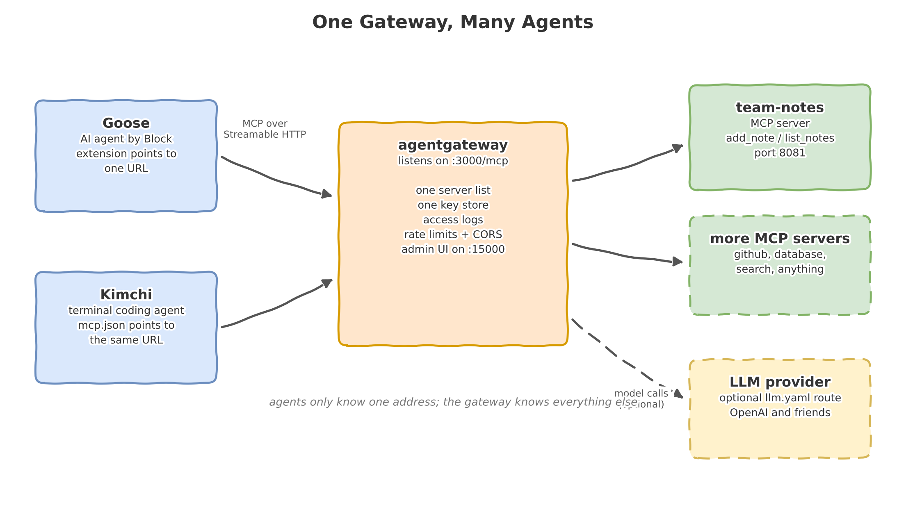
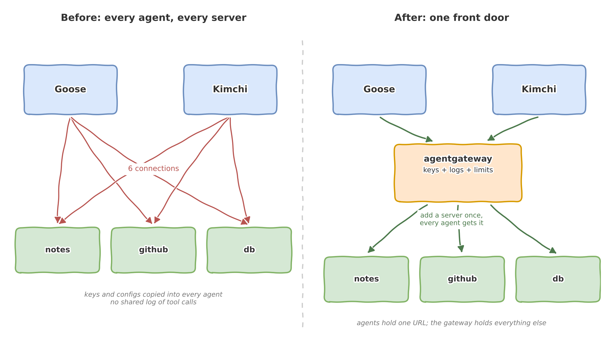

# One Gateway, Many Agents

Run two different AI agents, [Goose](https://github.com/block/goose) and [Kimchi](https://github.com/getkimchi/kimchi), behind one [agentgateway](https://github.com/agentgateway/agentgateway). Both agents share the same MCP tools through a single front door.



## The problem

Every agent you install brings its own config, its own copy of every MCP server entry, and its own API keys. Two agents and three MCP servers means six connections to manage. Nobody can answer a simple question: which agent called which tool, and when?

## The idea

Put one gateway in the middle. Agents connect to one URL. The gateway holds the server list, the keys, the logs, and the limits.

| Without a gateway | With agentgateway |
|---|---|
| Each agent has its own MCP server list | One list in `gateway/config.yaml` |
| Keys live in every agent config | Keys live in one place |
| No shared record of tool calls | One access log for every call |
| New server means N config edits | New server means one config edit |

## What is in this repo

```
one-gateway-many-agents/
├── gateway/
│   ├── config.yaml        # MCP front door on :3000
│   └── llm.yaml           # optional LLM front door on :4000 (Gemini by default)
├── mcp-server/            # team-notes: a tiny MCP server (TypeScript, Streamable HTTP)
├── agents/
│   ├── goose/README.md    # connect Goose to the gateway
│   └── kimchi/README.md   # connect Kimchi to the gateway
├── harness/pipeline.yaml  # the Harness pipeline: build, deploy, agents, cleanup
├── k8s/agent-platform.yaml# two gateways + team-notes for one pipeline run
├── Dockerfile             # builds the team-notes image
├── scripts/
│   ├── start-all.sh       # run the note server + gateway
│   ├── smoke-test.sh      # prove the chain works, no agent needed
│   └── ci-gate.sh         # pass or fail the release from the agent notes
├── docs/
│   ├── images/            # diagrams
│   └── talk.md            # talk title, abstract, outline
└── blog/                  # the companion blog post
```

The demo tool is a shared notepad. Goose writes a note. Kimchi reads it. Both go through the gateway, so the gateway logs show both agents by name.

## Quickstart

Prereqs: Node.js 20+, curl, and the agentgateway binary.

```bash
# 1. Install agentgateway
curl https://raw.githubusercontent.com/agentgateway/agentgateway/refs/heads/main/common/scripts/get-agentgateway | bash

# 2. Start everything
./scripts/start-all.sh

# 3. In a second terminal, prove the chain works
./scripts/smoke-test.sh
```

Expected output:

```
1. Open an MCP session through the gateway
   session opened
2. List tools through the gateway
"name":"add_note"
"name":"clear_notes"
"name":"list_notes"
3. Fake goose writes a note
Saved note d76b7b14
4. Fake kimchi reads it back
[d76b7b14] goose at 2026-07-12T15:23:37.612Z: deploy plan drafted, please review

PASS: one gateway, two agents, one shared tool.
```

Then connect the real agents:

- [Goose setup](agents/goose/README.md)
- [Kimchi setup](agents/kimchi/README.md)

## How the pieces relate



- **Goose** and **Kimchi** are MCP clients. They only know one URL: `http://localhost:3000/mcp`.
- **agentgateway** is the proxy. It accepts MCP over Streamable HTTP, applies policies (CORS here; auth, rate limits, and more if you want), and forwards calls to targets.
- **team-notes** is an MCP target. It never faces an agent directly.

Add a new target in `gateway/config.yaml` and every agent sees the new tools on the next session. No agent config changes.

## Watch the traffic

Open the admin UI at `http://localhost:15000/ui` while agents make calls. Every tool call shows up with the route it took. That single view is the whole point.

## Run it in a Harness pipeline

Goose and Kimchi can run as steps in a Harness pipeline (the new pipeline format, CI and CD). The pipeline has four stages:


| Stage | Type | What it does |
|---|---|---|
| Build | CI | Builds the team-notes image with a template step |
| Deploy | CD | Applies `k8s/agent-platform.yaml`: two gateways and team-notes |
| Agents | CD | Goose reviews the diff, Kimchi adds a test plan, an audit step prints the gateway logs, the gate decides |
| Cleanup | CD | Always deletes the namespace, even when the gate fails |

The model key (Gemini by default) goes into a Kubernetes secret that only the LLM gateway pod reads. Goose gets a fake key. Kimchi only needs its own key. Neither agent can leak the model key because neither holds it.

### Set it up

0. Push this repo to GitHub first. The pipeline clones it (as `Sonichigo/one-gateway-many-agents`, so change that name in the YAML if yours differs). Also set the `notes_image` input to a registry path you own, such as `youruser/team-notes-mcp`. Stage 1 builds the team-notes image and pushes it there, and Stage 2 pulls it. Nothing exists at that path until the Build stage runs once.
1. Create the Harness resources the YAML names: connectors `animesh_gh` and `animesh_dockerhub`, a delegate `delegate-animesh`, and a service, environment, and infrastructure for the deploy stage. Rename them to match yours.
2. Import `harness/pipeline.yaml` as a pipeline.
3. Run it. Set the inputs: `target_repo` (the repo to review), `notes_image`, `llm_api_key`, `llm_model`, `kimchi_api_key`.

### Try the gate on its own

The gate needs no agent. Start the stack, add two notes, and run it:

```bash
./scripts/start-all.sh                    # terminal 1
GATEWAY_URL=http://localhost:3000/mcp ./scripts/ci-gate.sh   # terminal 2
```

With no notes it fails. After a `goose` note and a `kimchi` note with a low risk, it passes. If the goose note says `RISK: high`, it fails again.

### Check these before you run it for real

These parts follow the docs but were not run end to end, so test them once:

- The image name and start command for agentgateway in `k8s/agent-platform.yaml`.
- The `buildAndPushToDocker@1.0.0` template inputs in your account.
- How your Harness version passes `secret` inputs into a script.
- Where the Kimchi installer puts the binary (the pipeline guesses a few paths).
- Goose's `OPENAI_HOST` value, if your gateway path differs.
- A live Gemini call through the gateway. The config is valid, but I could not reach Google from my test box.

### Use Azure or OpenAI instead of Gemini

Only the gateway changes. Edit the `llm.yaml` block in `k8s/agent-platform.yaml` (or `gateway/llm.yaml` on a laptop). The file `gateway/llm.yaml` has ready snippets for OpenAI and for Azure OpenAI or Foundry. Goose, Kimchi, and the pipeline steps stay the same. When a provider retires a model, change the `llm_model` input and run again.

## Versions used

Tested with agentgateway v1.7.0 (config checks and the tool chain) and v1.4.0-alpha.1, `@modelcontextprotocol/sdk` 1.x, Node.js 22. Goose and Kimchi both move fast; if a config field name changed, their built-in wizards (`goose configure`, `kimchi setup`) write the correct shape.

## License

Apache-2.0
